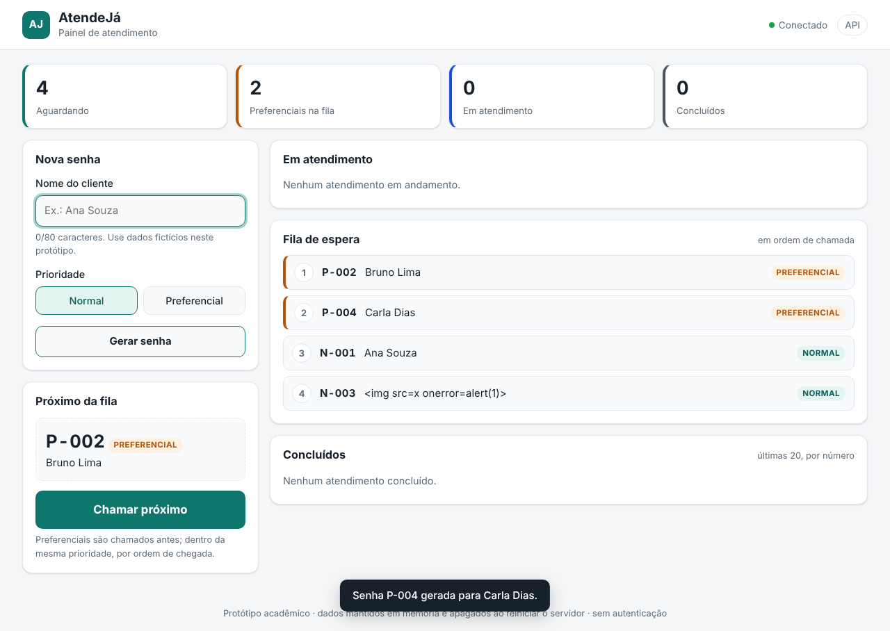
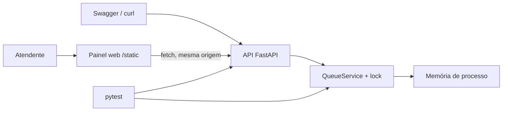

# AtendeJá — Gerenciamento de Fila de Atendimento

Protótipo acadêmico individual: API REST e painel web que criam senhas, ordenam atendimentos por prioridade, registram chamadas e concluem atendimentos.



## Tecnologias
Python 3.12+, FastAPI, pytest, HTTPX, Docker e GitHub Actions. O painel usa HTML, CSS e JavaScript puros servidos pela própria API, sem dependências extras nem etapa de build.

## Instalação e execução
```bash
python -m venv .venv
# Windows PowerShell:
.venv\Scripts\Activate.ps1
# Linux/macOS: source .venv/bin/activate
python -m pip install -r requirements.txt
python -m uvicorn app.main:app --reload
```
- Painel de atendimento: http://127.0.0.1:8000/
- Documentação Swagger da API: http://127.0.0.1:8000/docs

Execute com **um único worker**: a fila fica na memória do processo (ver limites abaixo).

## Painel web
- **Nova senha**: nome (1–80 caracteres) e prioridade normal/preferencial; gera códigos como `N-001` e `P-002`.
- **Próximo da fila** e botão **Chamar próximo**, desabilitado quando não há ninguém aguardando.
- **Em atendimento**: senhas chamadas, cada uma com o botão **Concluir atendimento**.
- **Fila de espera** na ordem exata de chamada (vinda de `GET /queue`) e lista de **concluídos**.
- Indicadores de aguardando, preferenciais, em atendimento e concluídos; atualização automática a cada 5 s para refletir outros terminais.
- Layout responsivo (celular a desktop), com modo escuro automático.

## Testes / harness
```bash
python -m pytest -v --junitxml=test-results.xml
```
Em Docker: `docker compose run --build --rm tests`; API e painel: `docker compose up --build api`.
GitHub Actions: `.github/workflows/ci.yml` publica relatório JUnit como artefato. Resultados, datas e limites da evidência: [docs/TESTES.md](docs/TESTES.md).

## Exemplo rápido (API)
```bash
curl -X POST http://127.0.0.1:8000/tickets -H 'Content-Type: application/json' -d '{"name":"Ana","priority":"preferencial"}'
curl http://127.0.0.1:8000/queue
curl -X POST http://127.0.0.1:8000/tickets/next
curl -X POST http://127.0.0.1:8000/tickets/1/finish
```

| Método e rota | Resposta |
|---|---|
| `POST /tickets` | 201 senha; 422 entrada inválida |
| `GET /tickets?status=` | 200 lista (filtro opcional por estado) |
| `GET /tickets/{id}` | 200 senha; 404 inexistente |
| `POST /tickets/next` | 200 senha chamada; 409 fila vazia |
| `POST /tickets/{id}/finish` | 200 concluída; 404 inexistente; 409 transição inválida |
| `GET /queue` (v1.1) | 200 senhas em espera na ordem de chamada |
| `GET /health` | 200 `{"status":"ok"}` |

## Arquitetura

`app/main.py`: camada HTTP, rota do painel e cabeçalhos de segurança. `app/domain.py`: validação, fila, ordem de chamada e transições de estado. `app/static/`: painel web. `tests`: testes de domínio, concorrência, API e painel.

## SDD, decisões, ética e revisão
- [Especificação funcional e técnica (v1.1)](docs/SDD.md)
- [ADRs](docs/DECISOES.md)
- [Registro de refinamentos v1.0 → v1.1](docs/REFINAMENTOS.md)
- [Registro de testes e evidências](docs/TESTES.md)
- [Análise técnico-ética de IA](docs/IA-ETICA.md)
- [Regras para agentes](AGENTS.md)

## Governança individual
Fluxo recomendado: `main` estável, `develop` para integração, `feature/*` para mudanças, com Pull Requests documentando autoinspeção de código e checks. O refinamento v1.1 foi feito na branch `feature/interface-web-e-refinamentos`, com apoio do Claude Code, e aguarda revisão humana antes do merge. O projeto foi desenvolvido individualmente; não se atribuem revisões a colaboradores inexistentes. Links de PRs reais devem ser adicionados ao relatório após criados.

## Limites de produção e segurança
- Sem autenticação, autorização ou rate limit: qualquer pessoa que alcance a porta pode operar a fila.
- Sem armazenamento persistente: reiniciar apaga a fila. O lock garante consistência só dentro de um processo.
- Sem política de dados pessoais: use apenas nomes fictícios.
- O painel mitiga XSS (renderização como texto e Content-Security-Policy), mas isso não substitui uma revisão de segurança.

Não utilize com dados reais de clientes até implementar as proteções necessárias. Decisões pendentes de homologação humana: [SDD, última seção](docs/SDD.md#decisões-que-exigem-homologação-humana).
