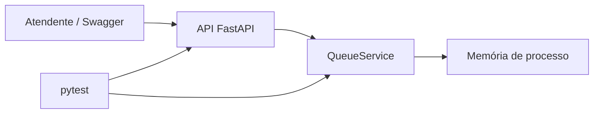

# AtendeJá — Gerenciamento de Fila de Atendimento

Protótipo acadêmico individual: API REST que cria senhas, ordena atendimentos por prioridade, registra chamadas e conclui atendimentos.

## Tecnologias
Python 3.12+, FastAPI, pytest, HTTPX, Docker e GitHub Actions.

## Instalação e execução
```bash
python -m venv .venv
# Windows PowerShell:
.venv\\Scripts\\Activate.ps1
# Linux/macOS: source .venv/bin/activate
python -m pip install -r requirements.txt
python -m uvicorn app.main:app --reload
```
Acesse http://127.0.0.1:8000/docs para interface Swagger.

## Testes / harness
```bash
python -m pytest -v --junitxml=test-results.xml
```
Em Docker: `docker compose run --build --rm tests`; API: `docker compose up --build api`.
GitHub Actions: `.github/workflows/ci.yml` publica relatório JUnit como artefato. Resultado e data da execução: `docs/TESTES.md`.

## Exemplo rápido
```bash
curl -X POST http://127.0.0.1:8000/tickets -H 'Content-Type: application/json' -d '{"name":"Ana","priority":"preferencial"}'
curl -X POST http://127.0.0.1:8000/tickets/next
```

## Arquitetura

`app/main.py`: camada HTTP. `app/domain.py`: validação, fila, transições de estado. `tests`: testes de domínio e da API.

## SDD, decisões, ética e revisão
- [Especificação funcional e técnica](docs/SDD.md)
- [ADRs](docs/DECISOES.md)
- [Registro de testes e falhas](docs/TESTES.md)
- [Análise técnico-ética de IA](docs/IA-ETICA.md)
- [Regras para agentes](AGENTS.md)

## Governança individual
Fluxo recomendado: `main` estável, `develop` para integração, `feature/*` para mudanças, com Pull Requests documentando autoinspeção de código e checks. O projeto foi desenvolvido individualmente; não se atribuem revisões a colaboradores inexistentes. Links de PRs reais devem ser adicionados ao relatório após criados.

## Limites de produção
Sem armazenamento persistente, autenticação ou rate limit; não utilizar com dados reais de clientes até implementar as proteções necessárias.
