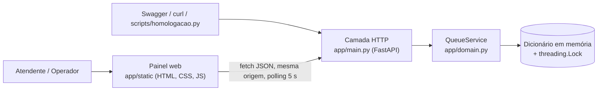
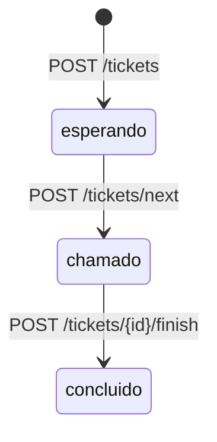

# SDD — AtendeJá 1.0.0 (As-Built)

Especificação definitiva do que foi **efetivamente entregue** na release 1.0.0. Cada regra abaixo aponta o código que a implementa e os testes que a verificam. Histórico da especificação: v1.0 (Entrega 2, só API) → v1.1 (painel web e correções, ver [REFINAMENTOS.md](REFINAMENTOS.md)) → 1.0.0 As-Built (Entrega 3). O número 1.0.0 segue o versionamento semântico da primeira release estável (ADR-011); "v1.0/v1.1" eram versões do documento.

## 1. Problema e escopo
Pequenos estabelecimentos precisam organizar senhas de atendimento com prioridade, rastreamento de estado e ordenação previsível. O AtendeJá é um serviço único (API REST + painel web) que mantém a fila em memória, sem serviços externos.

Fora do escopo desta release: autenticação, persistência, múltiplas filas/guichês, cancelamento ou rechamada de senha, painel público de TV, relatórios.

## 2. Atores
| Ator | Usa | Ações |
|---|---|---|
| Atendente | Painel (`/`) ou API | Cadastrar senha, chamar a próxima |
| Operador | Painel ou API | Concluir atendimento |
| Integrador/avaliador | Swagger (`/docs`), `curl`, script de homologação | Qualquer rota |

## 3. Arquitetura entregue


| Componente | Arquivo | Responsabilidade |
|---|---|---|
| Domínio | `app/domain.py` | `Priority`, `Status`, `Ticket`, `QueueService`: validação do nome, ids sequenciais, ordem de chamada (`_call_order`), transições de estado, lock |
| HTTP | `app/main.py` | `create_app()`, modelos `TicketInput`/`TicketOutput`, mapeamento de exceções para 404/409/422, rota do painel com cabeçalhos de segurança, arquivos estáticos |
| Versão | `app/__init__.py` | `__version__ = '1.0.0'`, exposta em `/openapi.json` |
| Painel | `app/static/index.html`, `styles.css`, `app.js` | Interface responsiva; consome somente a API pública |
| Testes | `tests/test_domain.py`, `tests/test_api.py`, `tests/test_homologacao.py` | 57 testes; 100% de linhas e ramos em `app/` |
| Homologação | `scripts/homologacao.py` | 8 cenários contra um servidor real (local ou Docker) |
| Execução | `Dockerfile` (estágios `runtime` e `test`), `docker-compose.yml` | Imagem de execução sem ferramentas de teste, usuário não-root |
| CI | `.github/workflows/ci.yml` | Testes + cobertura; artefatos `teste-junit` e `cobertura` |

Cada chamada a `create_app()` cria uma `QueueService` própria (isolamento entre testes). O módulo expõe `app = create_app()` para o uvicorn.

## 4. Modelo de domínio
`Ticket`: `id: int` (sequencial a partir de 1, nunca reutilizado), `name: str` (sem espaços nas bordas), `priority: normal|preferencial`, `status: esperando|chamado|concluido`, `created_at: datetime UTC`.

Máquina de estados, sem regressão nem cancelamento:


## 5. Regras de negócio
| Id | Regra | Implementação | Testes principais |
|---|---|---|---|
| RN01 | Nome obrigatório com 1–80 caracteres após remover espaços das bordas. Validado na API (Pydantic, `strip_whitespace`) e no domínio (`str.strip()`). Se só o domínio rejeitar (ex.: `"\x1f"`, que o Pydantic não remove), a resposta é 422 com a mensagem do domínio | `TicketInput`, `QueueService.create` | `test_invalid_name`, `test_name_at_max_length`, `test_name_padded_to_max_length_accepted`, `test_name_too_long_after_trim`, `test_domain_validation_reached_through_api` |
| RN02 | Prioridade `normal` (padrão) ou `preferencial`; outro valor gera 422 | `Priority`, `TicketInput` | `test_invalid_priority`, `test_create_preferred` |
| RN03 | Ordem de chamada: todos os preferenciais antes dos normais; dentro da mesma prioridade, menor id primeiro (FIFO) | `_call_order` | `test_priority_before_normal`, `test_preferred_fifo`, `test_fifo_same_priority` |
| RN04 | `GET /queue` e `POST /tickets/next` usam a mesma função de ordem; a sequência de chamadas coincide com a fila exibida | `waiting_queue`, `call_next` | `test_waiting_queue_matches_call_order`, `test_queue_order_and_excludes_non_waiting` |
| RN05 | Só se conclui senha `chamado`; concluir `esperando` ou `concluido` gera 409 | `QueueService.finish` | `test_cannot_finish_waiting`, `test_cannot_finish_twice`, `test_finish_waiting_conflict_detail` |
| RN06 | Chamar com fila vazia gera 409 | `QueueService.call_next` | `test_call_empty_queue`, `test_next_empty_detail` |
| RN07 | Operações atômicas no processo: uma senha nunca é chamada duas vezes e ids não se repetem sob concorrência | `QueueService._lock` | `test_concurrent_call_next_never_repeats_ticket`, `test_concurrent_create_unique_ids`, cenário `h07_concorrencia` |
| RN08 | Prioridade estrita: uma normal pode esperar indefinidamente se chegarem preferenciais continuamente (comportamento aceito no escopo acadêmico, ver ADR-003) | `_call_order` | `test_strict_priority_keeps_normal_waiting` |

## 6. Contratos da API (as-built)
Base: `http://<host>:8000`. Corpo e respostas em JSON UTF-8.

Objeto **senha** (`TicketOutput`):
```json
{"id": 1, "name": "Ana", "priority": "preferencial", "status": "esperando", "created_at": "2026-10-24T20:30:00.123456+00:00"}
```

| Método e rota | Entrada | Sucesso | Erros |
|---|---|---|---|
| `GET /health` | — | 200 `{"status":"ok"}` | — |
| `POST /tickets` | `{"name": str, "priority"?: "normal"\|"preferencial"}` | 201 senha | 422 (nome inválido, prioridade inválida, corpo ausente) |
| `GET /tickets` | `?status=esperando\|chamado\|concluido` (opcional) | 200 lista em ordem de criação | 422 estado inválido |
| `GET /tickets/{id}` | `id` inteiro | 200 senha | 404 `{"detail":"Senha não encontrada."}`; 422 id não inteiro |
| `POST /tickets/next` | — | 200 senha que passou a `chamado` | 409 `{"detail":"Não há senhas aguardando."}` |
| `POST /tickets/{id}/finish` | `id` inteiro | 200 senha `concluido` | 404 inexistente; 409 `{"detail":"Apenas senhas chamadas podem ser concluídas."}` |
| `GET /queue` | — | 200 lista de senhas `esperando` na ordem RN03 | — |
| `GET /` | — | 200 HTML do painel com `Content-Security-Policy: default-src 'self'; img-src 'self' data:; frame-ancestors 'none'`, `X-Content-Type-Options: nosniff`, `Referrer-Policy: no-referrer` | 405 para `HEAD` |
| `GET /static/{arquivo}` | — | 200 `app.js`, `styles.css`, `index.html` | 404 inexistente |
| `GET /docs`, `GET /openapi.json` | — | Swagger e esquema OpenAPI (`info.version = "1.0.0"`) | — |

Formato de `detail` nos erros: **texto** quando o erro vem das regras de domínio (404, 409 e o 422 de RN01); **lista de objetos** do FastAPI/Pydantic nos demais 422. O código de status é o contrato; o painel trata os dois formatos.

Compatibilidade: todas as rotas, métodos, status e campos da v1.0 (Entrega 2) estão preservados (`test_original_contract_routes_preserved`, `test_ticket_output_fields`). Desde a v1.0 houve três mudanças observáveis, todas correções de defeitos documentadas em REFINAMENTOS (R2, R3) e ADR-007: o 404 sem aspas extras, o 422 de nome em branco com `detail` em lista, e nomes com espaços nas bordas e até 80 caracteres úteis aceitos.

## 7. Painel web
| Função | Comportamento entregue |
|---|---|
| Nova senha | Nome + prioridade; validação no cliente (1–80 após remover espaços) e exibição do erro 422 da API; contador de caracteres |
| Próximo da fila | Mostra a primeira senha de `GET /queue`; botão "Chamar próximo" desabilitado com fila vazia |
| Em atendimento | Cartões das senhas `chamado`, cada um com "Concluir atendimento" |
| Fila de espera | Ordem de chamada com posição; destaque para preferenciais |
| Concluídos | Últimas 20 por número (o contrato não registra horário de conclusão) |
| Indicadores | Aguardando, preferenciais na fila, em atendimento, concluídos |
| Atualização | `GET /tickets` + `GET /queue` a cada 5 s com a aba visível e após cada ação |
| Códigos | `P-002` / `N-001`: prefixo pela prioridade + id com 3 dígitos (apenas exibição) |
| Acessibilidade e layout | Rótulos em todos os campos, `aria-live` nos avisos, foco visível, envio com Enter; layout verificado em 375 px e 1280 px; modo escuro e `prefers-reduced-motion` |
| Segurança | Dados renderizados só com `textContent`; sem CDN, sem `eval`/`innerHTML` (verificado por teste) |

## 8. Requisitos não funcionais (as-built)
| Id | Requisito | Evidência |
|---|---|---|
| RNF01 | API documentada em `/docs` | `h08_contrato_e_versao` |
| RNF02 | Regras separadas do framework HTTP | `app/domain.py` não importa FastAPI |
| RNF03 | Reprodutível com Python 3.12+ (venv) ou Docker | [HOMOLOGACAO.md](HOMOLOGACAO.md): execução local e em container |
| RNF04 | Testes e cobertura no CI, com limite mínimo de 95% (`fail_under`) | `pyproject.toml`, `ci.yml` |
| RNF05 | Sem dados sensíveis reais nem segredos no repositório | Auditoria de higiene em HOMOLOGACAO |
| RNF06 | Operações atômicas num processo | RN07 |
| RNF07 | Painel sem build nem dependências externas | `app/static/` |
| RNF08 | Imagem de execução com usuário não-root e sem pacotes de teste | HOMOLOGACAO, cenário D3 |

## 9. Configuração e execução
Sem variáveis de ambiente nem arquivos de configuração da aplicação. Porta padrão 8000 (definida no comando do uvicorn). Execute com **um único worker**. Dependências: `requirements.txt` (execução: fastapi, uvicorn, pydantic) e `requirements-dev.txt` (+ pytest, pytest-cov, httpx). Configuração do pytest/coverage em `pyproject.toml`.

## 10. Limitações conhecidas
1. Dados apenas em memória: reiniciar o processo ou container apaga a fila (verificado). Com vários workers, cada um teria uma fila diferente.
2. Sem autenticação, autorização, rate limiting ou trilha de auditoria. Não expor fora de rede controlada.
3. Sem política de dados pessoais (LGPD): usar apenas nomes fictícios.
4. RN08: risco de espera indefinida para senhas normais.
5. Nomes com caracteres invisíveis ou de controle (ex.: só `​`, ou `a\x00b`) são aceitos, pois a regra RN01 conta caracteres e não restringe quais. Endurecer isso é uma regra nova, que fica para decisão humana.
6. `HEAD /` responde 405.
7. O painel é verificado por testes HTTP no CI e por roteiro de navegador executado manualmente; não há teste de navegador no CI. Sem avaliação com usuários nem com leitor de tela.
8. As dependências são declaradas por faixa de versões; as versões exatas homologadas estão em `docs/evidencias/versoes-ambiente.txt`.

## 11. Decisões pendentes de homologação humana
Ver o checklist em [HOMOLOGACAO.md](HOMOLOGACAO.md#checklist-de-homologação-humana). Resumo: aprovar o PR e a release; aceitar as mudanças observáveis de erro; decidir RN08 com base legal (Lei nº 10.048/2000) e as limitações 5 e 8; definir autenticação e persistência antes de qualquer uso real.
